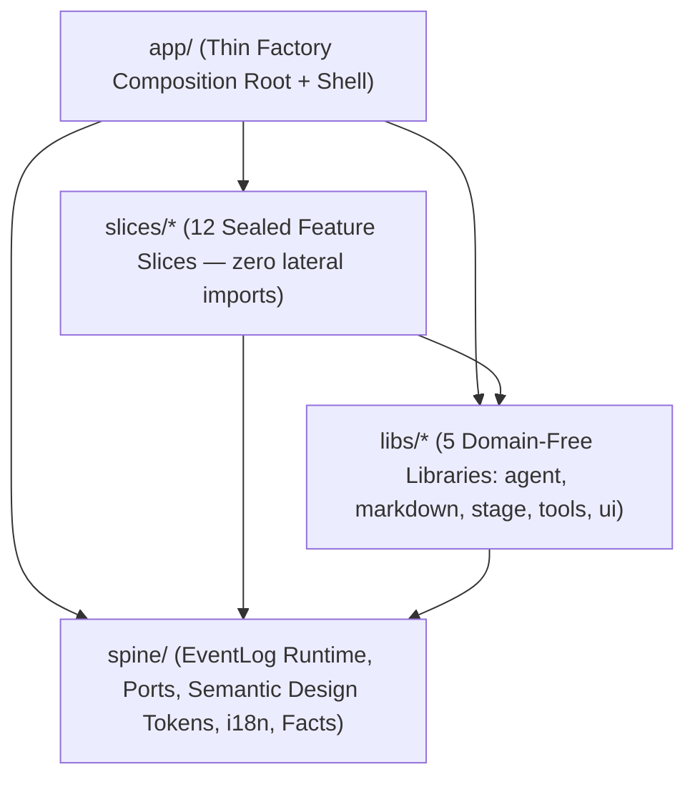

# Sealed Slice Architecture (SSA) — Reference Implementation

`deepseek-chat` is a working **Sealed Slice Architecture (Profile 1)** TypeScript + React + Tauri
application. Every feature is isolated into a sealed, factory-scoped slice with zero lateral imports,
zero module-level singletons, and mechanical CI verification.

## Tier DAG



## The 12 Sealed Slices

| Slice                | Package                                   | Role                                                             | Optional? | Owns                                                                     |
| :------------------- | :---------------------------------------- | :--------------------------------------------------------------- | :-------- | :----------------------------------------------------------------------- |
| `account`            | `@deepseek-chat/slice-account`            | DeepSeek API key hydration, verification, settings row           | Core      | `chat-demo:api-key`                                                      |
| `conversations`      | `@deepseek-chat/slice-conversations`      | Chats, branches, SSE loop, drafts, attachments, sider, views     | Core      | `chat-demo:thinking`, `deepseek-sessions`                                |
| `preferences`        | `@deepseek-chat/slice-preferences`        | Theme, locale, user location settings                            | Yes       | `chat-demo:theme-preference`, `chat-demo:locale`, `chat-demo:location`   |
| `voice`              | `@deepseek-chat/slice-voice`              | Voice dictation & read-aloud (stops on session/reply facts)      | Yes       | `chat-demo:tts-voice`                                                    |
| `web-research`       | `@deepseek-chat/slice-web-research`       | `web_search`, `web_scrape`, `research` subagent profile          | Yes       | `chat-demo:search`, Firecrawl key                                        |
| `python`             | `@deepseek-chat/slice-python`             | Pyodide web worker / native desktop sandbox Python runner        | Yes       | `chat-demo:python`, uploads mounting                                     |
| `workspace-files`    | `@deepseek-chat/slice-workspace-files`    | `present_file`, `edit_file`, `read_file`, File Preview panel     | Yes       | Artifact versions, `HeaderToggle`, `PreviewPanel`                        |
| `browser`            | `@deepseek-chat/slice-browser`            | Desktop built-in multi-tab browser & visual inspection tools     | Yes       | `chat-demo:browser`, `chat-demo:browser-allow-localhost`, `HeaderToggle` |
| `ask-user`           | `@deepseek-chat/slice-ask-user`           | `ask_user` clarifying question tool & composer dock              | Yes       | `ComposerDock`, Front Stage summary notes                                |
| `subagents`          | `@deepseek-chat/slice-subagents`          | Parallel read-only subagent runner, shared board, `wait`, `post` | Yes       | `TurnLifecycleHooks` (`auto-wait`, settle, hydrate)                      |
| `activity-inspector` | `@deepseek-chat/slice-activity-inspector` | Right-hand Turn Activity & Sources panel                         | Yes       | Delegates per-step rendering to `ToolStepPresenter`                      |
| `history-backup`     | `@deepseek-chat/slice-history-backup`     | Export/import v3 ZIP archives & Settings Data tab                | Yes       | Delegates tool serialization to `serializeForArchive`                    |

## Collaboration Without Coupling

Slices never import each other. They collaborate through three narrow, domain-blind mechanisms:

1. **Open Capability Registry (`@deepseek-chat/lib-tools`):**
   Every tool-bearing slice exports a single `capability: ToolCapability` object describing its
   composer `toggle`, `declareTools`, `instructions`, `handles`, `effectOf`, optional `agentProfile`,
   `run`, `presenter` (`summarize` + `renderActivity`), `serializeForArchive`, and optional
   `turnHooks`. `createToolRegistry(capabilities, COMPOSITION_PROMPT_NOTES)` in
   [`app/runtime.ts`](../app/runtime.ts) aggregates all mounted capabilities, injects the universal
   `summary` parameter first on every schema, and serves `conversations`, `subagents`,
   `activity-inspector`, and `history-backup` without any `switch (kind)` router.
2. **Spine `EventLog` Facts (`@deepseek-chat/spine/facts/*`):**
   - Sticky facts (replayed to late subscribers, tombstoned on delete): `ActiveSessionChanged`
     (key `'unit'`), `SessionFilesChanged` (key `sessionId`).
   - Discrete facts: `ReplyLifecycleChanged`, `ToolFileDelivered`, `TurnInspectionRequested`,
     `SessionDeleted`, `SessionHistoryReplaced`, `BrowserControlTakenOver`.
3. **Domain-Blind Ports (`@deepseek-chat/spine/ports`):**
   `KeyValueStore`, `BlobStore` (`deepseek-blobs` in production, `memoryBlobStore()` in tests),
   `PanelSlot`, `NoticePort`, `OverlayPort`, `HttpFetch`, `SecretSlot`.

## Adding or Removing a Capability Slice in 1 Line

Because every slice is sealed and `conversations`, `activity-inspector`, and `history-backup` are
domain-blind:

- **Remove any optional slice:** pass `enabledSlices: { python: false }` (or omit it in
  `app/runtime.ts`). Its composer toggle, header toggle, settings rows, tools, prompt instructions,
  and right-hand panel disappear cleanly with zero edits to any other slice.
- **Add a brand-new slice:** implement `createMySlice(deps)` exporting `capability: ToolCapability`
  and `dispose()`, then pass it in `extraCapabilities` (or append it to the `capabilities` array in
  `app/runtime.ts`). Composer toggle, tool execution, `summary` schema prepending, Work Strip tally,
  Activity Inspector lane, and v3 ZIP archive serialization work immediately without modifying any
  existing slice.

## Mechanical Verification (CI Gates)

Run `pnpm check:dag` and `pnpm check:design` to verify all boundaries mechanically:

| Rule                                  | Enforced In                | What It Guarantees                                                                                |
| :------------------------------------ | :------------------------- | :------------------------------------------------------------------------------------------------ |
| **DAG & Anatomy**                     | `scripts/check-dag.mjs`    | Strict 4-tier hierarchy, zero lateral slice imports, single `.` export, package-only test imports |
| **S1 (`NO-SINGLETON`)**               | `scripts/check-dag.mjs`    | Zero module-level Zustand `create(` or `indexedDB.open(`/`openDB(` in `slices/*/src`              |
| **S2 (`DISPOSE`)**                    | `scripts/check-dag.mjs`    | Every slice exports `create*Slice` returning `dispose()`                                          |
| **S3 (`NO-LATE-BINDINGS`)**           | `scripts/check-dag.mjs`    | No `lateBindings` modules or imports anywhere in `app/`                                           |
| **S4 (`DOMAIN-BLIND-CONVERSATIONS`)** | `scripts/check-dag.mjs`    | Zero sibling-slice tool or runtime identifiers inside `slices/conversations/src`                  |
| **S5 (`APP-OWNERSHIP`)**              | `scripts/check-dag.mjs`    | Production `app/` renders no `SettingRow` directly and owns no feature `chat-demo:*` storage keys |
| **Design Tokens & AA Contrast**       | `scripts/check-design.mjs` | `@layer` isolation, semantic `--ui-*` tokens only, 26 WCAG 2.2 AA contrast pairs (light & dark)   |

## Proving SSA Live

- **Automated Proof Suite:**

  ```bash
  node --import ./scripts/test-loader.mjs --test app/tests/ssa_proof.test.ts
  ```

  Proves (1) multi-instance isolation in one process, (2) bare 2-slice boot and the full N-1 slice
  omission matrix, (3) zero-touch drop-in synthetic `calculator` slice across all 5 surfaces, and
  (4) Spine `EventLog` sticky replay, causal envelopes, and tombstone eviction.

- **Interactive SSA Live Demo (Dev Workbench):**
  ```bash
  pnpm dev:ssa
  ```
  Opens the dev-only SSA Live Demo (`/?workbench=1&tab=ssa`) where you can toggle slices on and off
  live, run offline scripted tool flows, inspect real-time Spine `EventLog` envelopes, and interact
  with two isolated `<App />` instances side by side in the same browser tab.
