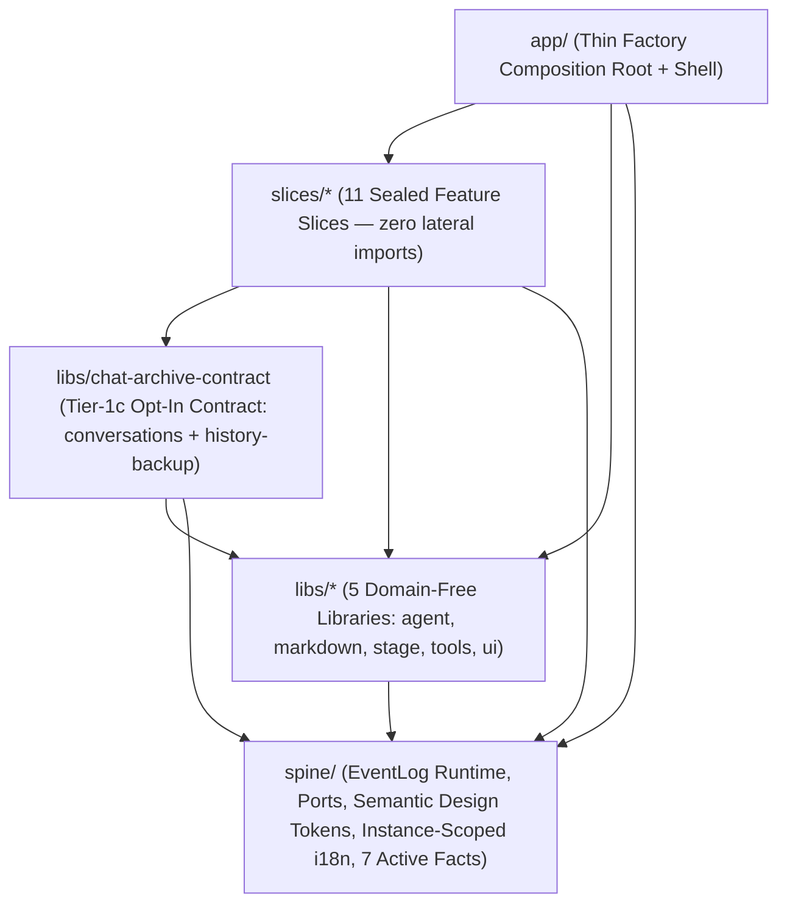

# Clean-Slate Architecture (CSA) / Sealed Slice Reference

`deepseek-chat` is a TypeScript + React + Tauri desktop/web application structured under
**Clean-Slate Architecture (CSA)** with compiler-enforced package walls (`pnpm` workspaces +
`tsc -b` Project References), factory-scoped multi-instance slices, Depth-2 cell isolation, and
mechanical CI verification.

## Tier DAG



## The 11 Sealed Slices

| Slice             | Package                                | Role                                                                                               | Optional? | Owns                                                                     |
| :---------------- | :------------------------------------- | :------------------------------------------------------------------------------------------------- | :-------- | :----------------------------------------------------------------------- |
| `account`         | `@deepseek-chat/slice-account`         | DeepSeek API key hydration, verification, settings row                                             | Core      | `chat-demo:api-key`                                                      |
| `conversations`   | `@deepseek-chat/slice-conversations`   | Depth-2 (`kernel/` + 5 cells: `storage`, `compaction`, `turn-loop`, `views`, `activity-inspector`) | Core      | `chat-demo:thinking`, `deepseek-sessions`, Activity & Sources drawer     |
| `preferences`     | `@deepseek-chat/slice-preferences`     | Theme, locale, user location settings                                                              | Yes       | `chat-demo:theme-preference`, `chat-demo:locale`, `chat-demo:location`   |
| `voice`           | `@deepseek-chat/slice-voice`           | Voice dictation & read-aloud (stops on session/reply facts)                                        | Yes       | `chat-demo:tts-voice`                                                    |
| `web-research`    | `@deepseek-chat/slice-web-research`    | `web_search`, `web_scrape`, `research` subagent profile                                            | Yes       | `chat-demo:search`, Firecrawl key                                        |
| `python`          | `@deepseek-chat/slice-python`          | Pyodide web worker / native desktop sandbox Python runner                                          | Yes       | `chat-demo:python`, uploads mounting                                     |
| `workspace-files` | `@deepseek-chat/slice-workspace-files` | Depth-1: `present_file`, `edit_file`, `read_file`, File Preview panel (compact, single-owner)      | Yes       | Artifact versions, `HeaderToggle`, `PreviewPanel`                        |
| `browser`         | `@deepseek-chat/slice-browser`         | Depth-2 (`kernel/` + 3 cells: `runtime`, `tools`, `panel`): desktop multi-tab browser & tools      | Yes       | `chat-demo:browser`, `chat-demo:browser-allow-localhost`, `HeaderToggle` |
| `ask-user`        | `@deepseek-chat/slice-ask-user`        | `ask_user` clarifying question tool & composer dock                                                | Yes       | `ComposerDock`, Front Stage summary notes                                |
| `subagents`       | `@deepseek-chat/slice-subagents`       | Parallel read-only subagent runner, shared board, `wait`, `post` (eager non-recursive host)        | Yes       | `TurnLifecycleHooks` (`auto-wait`, settle, hydrate)                      |
| `history-backup`  | `@deepseek-chat/slice-history-backup`  | Export/import v3 ZIP archives & Settings Data tab                                                  | Yes       | Delegates tool serialization to `serializeForArchive`                    |

## Collaboration Without Coupling

Slices never import each other. They collaborate through four narrow, mechanically verified
mechanisms:

1. **Open Capability Registry (`@deepseek-chat/lib-tools`):**
   Every tool-bearing slice exports a single `capability: ToolCapability` object describing its
   composer `toggle`, `declareTools`, `instructions`, `handles`, `effectOf`, optional `agentProfile`,
   `run`, `presenter` (`summarize` + `renderActivity`), `serializeForArchive`, and optional
   `turnHooks`. [`app/runtime.ts`](../app/runtime.ts) first builds `childToolHost` from all
   non-subagent capabilities (making recursive subagent spawning structurally impossible), wires
   `subagents` eagerly, and composes the final `ToolRegistry` without forward-reference mutations.
2. **Spine `EventLog` Facts (`@deepseek-chat/spine/facts/*` — 7 Active Cross-Slice Facts):**
   - Sticky facts (replayed to late subscribers, tombstoned on delete): `ActiveSessionChanged`
     (key `'unit'`), `SessionFilesChanged` (key `sessionId`).
   - Discrete facts: `ReplyLifecycleChanged`, `ToolFileDelivered`, `SessionDeleted`,
     `SessionHistoryReplaced`, `BrowserControlTakenOver`.
3. **Opt-In Tier-`1c` Contract (`@deepseek-chat/lib-chat-archive-contract`):**
   Pure persisted chat session/message schema and `ChatArchiveSessionsPort`, mechanically allowlisted
   strictly to `slices/conversations` and `slices/history-backup` so both wire in `app/runtime.ts`
   with zero casts and zero duplicated DTOs.
4. **Domain-Blind Ports (`@deepseek-chat/spine/ports`):**
   `KeyValueStore`, `BlobStore` (`deepseek-blobs` in production, `memoryBlobStore()` in tests),
   `PanelSlot`, `NoticePort`, `OverlayPort`, `HttpFetch`, `SecretSlot`.

## Adding or Removing a Capability Slice in 1 Line

Because every slice is sealed and `conversations` (including its `cells/activity-inspector/` cell)
and `history-backup` are domain-blind:

- **Remove any optional slice:** pass `enabledSlices: { python: false }` (or omit it in
  `app/runtime.ts`). Its composer toggle, header toggle, settings rows, tools, prompt instructions,
  and right-hand panel disappear cleanly with zero edits to any other slice.
- **Add a brand-new slice:** implement `createMySlice(deps)` exporting `capability: ToolCapability`
  and `dispose()`, then pass it in `extraCapabilities` (or append it to `baseCapabilities` in
  `app/runtime.ts`). Composer toggle, tool execution, `summary` schema prepending, Work Strip tally,
  Activity Inspector lane, subagent profile discovery, and v3 ZIP archive serialization work
  immediately without modifying any existing slice.

## Depth-2 Graduation Discipline

CSA graduates a slice to Depth-2 (`kernel/` + `cells/*` + thin `src/`) only when its size and state
complexity justify shrinking the per-task Working Set Radius:

- **`slices/browser`** (`kernel/` + `cells/{runtime,tools,panel}`): pure URL/tab/control-sum-type
  reducer and native IPC sync planner in `kernel/`; `PanelSlot` is sole owner of `panelOpen` (no
  shadow copy); IPC failures invalidate the sync cache instead of poisoning it.
- **`slices/conversations`** (`kernel/` + `cells/{storage,compaction,turn-loop,views,activity-inspector}`):
  pure session lifecycle, `HistoryPhase` / `SessionActivity` sum types, LRU eviction pinning, and
  `historyEpoch` in `kernel/`; non-serializable `AbortController` handles stay strictly out of
  Zustand; `TurnSessionGateway` decouples `turn-loop` from `compaction`.
- **`slices/workspace-files`** deliberately stays flat at Depth-1 (~3.2K LOC, compact `state.ts`,
  already uses `PanelSlot` as sole owner with zero state duplication).

## Mechanical Verification (CI Gates)

Run `pnpm type`, `pnpm check:dag`, `pnpm check:ipc`, and `pnpm check:design` to verify all
boundaries mechanically:

| Rule                              | Enforced In                 | What It Guarantees                                                                                            |
| :-------------------------------- | :-------------------------- | :------------------------------------------------------------------------------------------------------------ |
| **Compiler Walls (`tsc -b`)**     | `tsconfig.prod.json` + refs | Workspace-enforced package boundaries and dev-only `@deepseek-chat/test-support` ban in production            |
| **DAG, Tier-`1c`, & `TSCONFIG`**  | `scripts/check-dag.mjs`     | Strict tier DAG, `[CONTRACT-SCOPE]` allowlists, single `.` export, synced `tsconfig` refs, Depth-2 `include`  |
| **Depth-2 `KERNEL-PURITY`**       | `scripts/check-dag.mjs`     | `kernel/` bans `.tsx`, `.css`, React/Zustand/IDB/`lib-ui`/`lib-markdown`, `src/`, `cells/`; single `index.js` |
| **Strict `CELL-ISOLATION`**       | `scripts/check-dag.mjs`     | Cells never cross-import siblings or import `src/`; external code imports only `cells/<name>/index.js`        |
| **Zero Orphan Spine Facts**       | `scripts/check-dag.mjs`     | Every fact in `spine/facts/` is referenced by >= 2 distinct production packages (`[ORPHAN-FACT]`)             |
| **S1–S5 Lifecycle & Ownership**   | `scripts/check-dag.mjs`     | Factory-scoped stores/IDB (S1), `dispose()` (S2), no `lateBindings` (S3), domain-blind conversations (S4), S5 |
| **Rust ↔ TS IPC & Policy Parity** | `scripts/check-ipc.mjs`     | 1-to-1 parity across 33 Tauri commands, 6 events, centralized bridge, and 4 cross-language policy invariants  |
| **Design Tokens & AA Contrast**   | `scripts/check-design.mjs`  | `@layer` isolation, semantic `--ui-*` tokens only, 40 WCAG 2.2 AA contrast pairs (light & dark)               |

## Proving CSA / SSA Live

- **Automated Proof Suite:**

  ```bash
  node --import ./scripts/test-loader.mjs --test app/tests/ssa_proof.test.ts
  ```

  Proves (1) multi-instance isolation in one process, (2) bare 2-slice boot and the full N-1
  optional slice omission matrix (9 optional slices), (3) zero-touch drop-in synthetic `calculator`
  slice across all surfaces, and (4) Spine `EventLog` sticky replay, causal envelopes, and tombstone
  eviction.

- **Interactive Live Demo (Dev Workbench):**
  ```bash
  pnpm dev:ssa
  ```
  Opens the dev-only Live Demo (`/?workbench=1&tab=ssa`) where you can toggle slices on and off
  live, run offline scripted tool flows, inspect real-time Spine `EventLog` envelopes, and interact
  with two isolated `<App />` instances side by side in the same browser tab.
